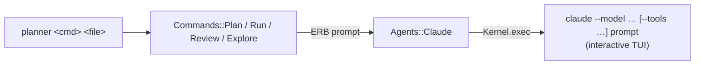
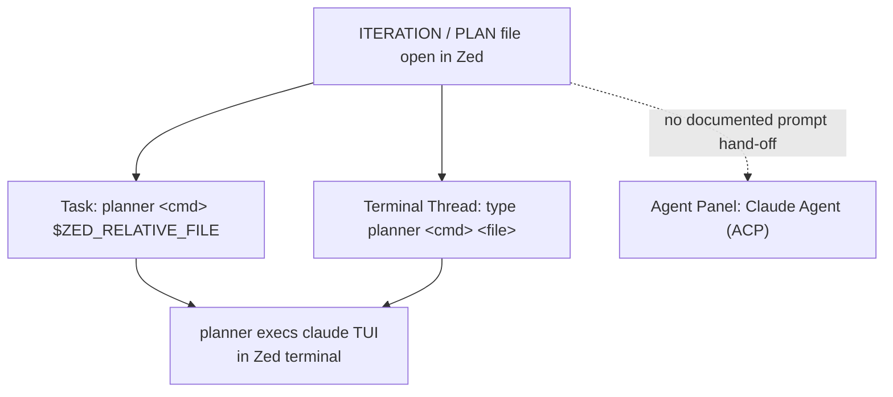
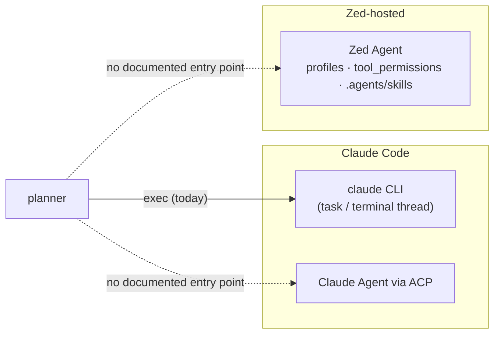

# FINDINGS-001 — Using planner commands with the Zed editor

## Questions

1. How could planner's commands (`new`, `plan`, `run`, `review`, `explore`) be run from inside Zed?
2. How could the process these commands support (iteration → plan → review → run, and iteration → explore) work with Zed's agent surfaces, keeping Claude Code as the main agent?
3. How could Zed-hosted models supplement Claude Code in that process?

## Decisions (resolved, do not revisit)

| Decision | Choice |
| --- | --- |
| Zed surfaces in scope | (a) Tasks, (b) Agent Panel / External Agents (ACP), (c) Zed's own agent as a supplement. Extensions and skills/rules are out of scope. |
| Agent | Mainly stay with Claude Code (`claude` CLI), and add Zed-hosted models alongside it |
| Commands | `new`, `plan`, `run`, `review`, `explore` (not `skills`) |
| Config scope | Both user-level (`~/.config/zed/`) and project-level (`.zed/`) |
| Zed version | Latest stable, per zed.dev docs fetched 2026-10-30 |

## Findings

### 1. How planner hands off to the agent today

- Every agent-driven command builds a prompt from an ERB template, then calls one method on `@context.agent`: `plan` at `lib/planner/commands/plan.rb:22`, `run` at `lib/planner/commands/run.rb:20`, `review` at `lib/planner/commands/review.rb:24-25`, and `explore` at `lib/planner/commands/explore.rb:24`.
- The only agent is `Agents::Claude`. By default it uses `Kernel.exec` (`lib/planner/agents/claude.rb:15`), so the `planner` process is replaced by an interactive `claude` session, with the whole rendered prompt passed as the last argv entry (`claude.rb:19-35`).
- Restrictions per command are passed as `claude` flags. `review` gets `--tools=Read,Grep,Glob,Write` and `--allowedTools=Edit(<review>),Edit(<plan>)` (`claude.rb:11,27-30`). `explore` gets `--tools=Read,Grep,Glob,Write,WebFetch` and `--allowedTools=Edit(<findings>),WebFetch` (`claude.rb:13,32-35`). `plan` uses a hard-coded `opus` (`claude.rb:8,20`, also listed in `docs/TODO.md:3`).
- The class comment says its public methods are "the contract a future agent must implement" (`claude.rb:5-6`). The agent is chosen in one place, `exe/planner:10`.
- `planner new` does not involve the agent. It creates `docs/plans/<stamp>-<slug>` and prints the path relative to the root (`lib/planner/commands/new.rb:15-19,28-29`). The root is the current working directory (`exe/planner:7`).
- The prompts are mostly agent-neutral. The only tool-specific wording is about permission prompts and the sandbox in the stats section (`lib/planner/prompts/run.md.erb:42-43`, `lib/planner/prompts/explore.md.erb:78-79`).
- File-name rules that matter for editor integration: `plan` and `explore` require `ITERATION-<N>.md` (`plan.rb:18-19`, `explore.rb:19-20`), `review` requires `PLAN-<N>.md` (`review.rb:19-20`), and `run` takes any existing file (`run.rb:17-18`).

### 2. Zed surfaces relevant to the brief

Zed offers three ways to run an agent (https://zed.dev/docs/ai/agents.md):

| Surface | Runs in | Auth, models and config owned by |
| --- | --- | --- |
| Zed Agent | Agent Panel / Threads Sidebar | Zed's LLM providers, including Zed-hosted models. Uses Zed tools, skills, instructions and profiles. |
| External Agents (ACP), e.g. Claude Agent | Agent Panel / Threads Sidebar | The agent's own process and config |
| Terminal Threads | Threads Sidebar, terminal-backed | The native CLI/TUI, e.g. `claude` |

Tasks (https://zed.dev/docs/tasks.md) run shell commands in Zed's built-in terminal.

### 3. Tasks (surface a)

Source: https://zed.dev/docs/tasks.md

- **Locations:** user-level `~/.config/zed/tasks.json` (opened with `zed: open tasks`), project-level `.zed/tasks.json` (`zed: open project tasks`), and one-off "oneshot" commands typed into the task modal.
- **Fields:** `label`, `command`, `args`, `env`, `cwd` (defaults to the project root), `use_new_terminal` (default `false`), `allow_concurrent_runs` (default `false`), `reveal` (`always` / `no_focus` / `never`), `hide` (`never` / `always` / `on_success`), `shell`, `save`, `tags`, `show_summary`, `show_command`, `hooks`.
- **File variables:** `ZED_FILE` (absolute path), `ZED_RELATIVE_FILE` (relative to `ZED_WORKTREE_ROOT`), `ZED_FILENAME`, `ZED_STEM`, `ZED_DIRNAME`, `ZED_RELATIVE_DIR`, `ZED_SELECTED_TEXT`, `ZED_WORKTREE_ROOT`, and others. The docs recommend putting variables in `args` to avoid quoting problems.
- **Filtering:** a task that uses an unavailable variable is hidden from the modal unless it has a default (`${VAR:default}`).
- **Shell:** tasks run in a login shell, so `.zshrc` and similar files are sourced. That matters for mise shims, since the README says to run `mise reshim` (`README.md:11`).
- **Keybindings:** a `keymap.json` entry can bind `task::Spawn` with `{"task_name": …, "reveal_target": "center"}`. The docs only mention a user-level keymap, not a project one.
- **Input:** there is no dedicated prompt-for-input feature. The closest options are oneshot commands, or pressing `tab` on a task to edit its command before running.

How these map onto planner:

| planner command | Task inputs available in Zed | Notes |
| --- | --- | --- |
| `planner new <given-name>` | `${ZED_SELECTED_TEXT}`, or a oneshot / `tab`-edited command | `cwd` defaults to the project root, which `planner` uses as its root (`exe/planner:7`). The new folder's path is printed to the terminal (`new.rb:19`). |
| `planner plan <iteration-file>` | `$ZED_RELATIVE_FILE` while `ITERATION-*.md` is open | Planner rejects other file names (`plan.rb:18-19`). Zed's task modal does not filter by file name. |
| `planner explore [--model] <iteration-file>` | `$ZED_RELATIVE_FILE` | Same file-name rule (`explore.rb:19-20`) |
| `planner review [--model] [--lens] <plan-file>` | `$ZED_RELATIVE_FILE`, and `${ZED_SELECTED_TEXT}` could feed `--lens` | `--lens -` reads stdin (`review.rb:44`). Requires `PLAN-*.md` (`review.rb:19-20`). |
| `planner run [--model] <plan-file>` | `$ZED_RELATIVE_FILE` | No file-name check (`run.rb:17-18`, `docs/TODO.md:6`) |

- Because `Agents::Claude` calls `exec` into an interactive `claude` TUI, a task's terminal becomes the Claude Code session. The task finishes only when the session ends. With `allow_concurrent_runs: false` (the default), rerunning the same task waits for that to happen.

### 4. Claude Code inside Zed: Terminal Threads and External Agents (surface b)

#### Terminal Threads

Source: https://zed.dev/docs/ai/terminal-threads.md

- These are terminal-backed threads in the Threads Sidebar for running an agent CLI/TUI. The docs use `claude` as the example.
- To start one, open the Agent Panel's new-thread menu and choose **Terminal**. `agent.terminal_init_command` is "sent to the shell as if you had typed it" whenever a Terminal Thread is created or recreated.
- The CLI keeps its own auth, models, tools, skills, instructions and MCP. Zed Agent profiles, tool permissions, skills and MCP "do not automatically apply". Terminal Threads are closed rather than archived and do not go to Thread History.
- Bell notifications are controlled by `agent.notify_when_agent_waiting` and `agent.play_sound_when_agent_done`. On the Claude Code side, the docs mention `preferredNotifChannel: "terminal_bell"`.
- For planner: running `planner plan|explore|review|run <file>` in a Terminal Thread gives the same `exec` → `claude` TUI as an ordinary terminal (§1), but it gets a sidebar entry and notifications. The docs do not describe a way for a task to open a Terminal Thread. `terminal_init_command` is a single fixed command, not one per file.

#### External Agents (ACP, "Claude Agent")

Sources: https://zed.dev/docs/ai/external-agents.md, https://github.com/zed-industries/claude-code-acp

- Claude Agent runs as a separate process speaking the Agent Client Protocol. It is installed from the ACP registry (`zed: acp registry`, or Agent Settings → External Agents → Add Agent).
- Its auth is separate from Zed's: run `/login` and choose an API key or Claude Code where supported. It can read `CLAUDE.md` and its own native configuration.
- Settings go under `agent_servers.<agent-id>`. The docs do not give Claude's agent id. Custom agents use `{"type": "custom", "command", "args", "env"}`.
- The adapter is `claude-agent-acp` (npm `@agentclientprotocol/claude-agent-acp`). Its README lists "Context @-mentions", "Tool calls (with permission requests)", "Custom Slash commands", "Client MCP servers", "Edit review", and model and effort defaults. Skills and `CLAUDE.md` are not mentioned.
- **What is missing:** none of the pages read describe an action, CLI flag, or `zed://` URL that starts a thread with a pre-filled prompt (external-agents.md, agent-panel.md, https://zed.dev/docs/reference/cli.md). The `zed` CLI has no subcommands, and the only `zed://` example is `zed://settings`.
- Planner's design (render a prompt, then `exec` `claude` with per-command `--tools` / `--allowedTools`) has no counterpart here. In an ACP thread the prompt would have to be entered in the panel, for example as a custom slash command or by @-mentioning the iteration file. Restrictions would come from Claude's own settings or the permission prompts forwarded over ACP.

### 5. Zed-hosted models and Zed Agent (surface c)

Sources: https://zed.dev/docs/account/zed-hosted-models.md, https://zed.dev/docs/ai/agent-panel.md, https://zed.dev/docs/ai/agent-profiles.md, https://zed.dev/docs/ai/tool-permissions.md, https://zed.dev/docs/ai/skills.md, https://zed.dev/docs/ai/instructions.md

- **Hosted models:** the Anthropic models include Claude Fable 5.1 / 5, Opus 5.5 / 5 / 4.5–4.8, Sonnet 5.5 / 5 / 4.5 / 4.6, and Haiku 4.5. Zed Pro and Business include all of them. The Student plan excludes Fable and Opus, and the Pro trial includes no Anthropic models. The page does not say whether External Agents or Terminal Threads can use hosted models. The comparison page says Zed Agent "uses models configured in Zed" and the others "may use their own model setup" (https://zed.dev/docs/ai/agents.md).
- **Planner hand-off:** there is no CLI entry point to Zed Agent. The CLI reference documents no command to start a thread or send a prompt. That leaves planner without a counterpart to `Kernel.exec('claude', …)` for a Zed-hosted model.
- **Profiles** (`agent.profiles`): each profile has `name`, a `tools` map of booleans (e.g. `read_file`, `grep`, `terminal`, `edit_file`), `enable_all_context_servers` / `context_servers`, and `default_model: {provider, model}`. The built-in profiles are Write, Ask (read-only questions) and Minimal. Whether `default_model` is a hard pin, and whether profiles can be set per project, is not documented.
- **Tool permissions** (`agent.tool_permissions`): `default` is `confirm` / `allow` / `deny`, with per-tool `tools.<tool>.default` and `always_allow` / `always_deny` / `always_confirm` regex patterns. `edit_file` patterns match the file path. This is the closest Zed Agent counterpart to `--allowedTools=Edit(<file>)` (`claude.rb:29,34`). The docs do not say whether paths are relative or absolute.
- **Skills:** Zed Agent reads `SKILL.md` folders only from `~/.agents/skills/` and `<worktree>/.agents/skills/`. `.claude/skills` is not mentioned. Skills can be run by the model, from a `/` slash command, or with an `@skill` mention, and `disable-model-invocation: true` limits them to manual use. Passing arguments is not documented. Skills apply to Zed Agent only, not to External Agents or Terminal Threads.
- **Instructions:** Zed Agent reads personal `~/.config/zed/AGENTS.md`, plus the first project file found in this order: `.rules`, `.cursorrules`, …, `AGENTS.md`, `CLAUDE.md`, `GEMINI.md`. Claude reads `CLAUDE.md` natively.
- **Prompt delivery:** in a Zed Agent thread, the iteration or plan file can be added with `@` mentions (files, directories, threads, skills, URLs). The panel docs list `agent: new thread` and `agent: new external agent thread`, but no action that takes a prompt.

### 6. User-level vs project-level configuration

| File | User | Project | Source |
| --- | --- | --- | --- |
| Tasks | `~/.config/zed/tasks.json` | `.zed/tasks.json` | tasks.md |
| Settings | `~/.config/zed/settings.json` (shown as an example label) | `.zed/settings.json`, "merged on top of user settings" | configuring-zed.md |
| Keymap | `keymap.json` (user) | not documented | tasks.md, configuring-zed.md |
| Skills (Zed Agent) | `~/.agents/skills/` | `<worktree>/.agents/skills/` (trusted worktrees only) | skills.md |
| Instructions | `~/.config/zed/AGENTS.md` | `.rules` … `AGENTS.md` / `CLAUDE.md` | instructions.md |

- None of the pages read say whether `agent.*` settings (profiles, `tool_permissions`, `terminal_init_command`) or `agent_servers` take effect in `.zed/settings.json`, or only in user settings (agent-settings.md, configuring-zed.md, agent-profiles.md).

---

## Stats

| Field | Value |
| --- | --- |
| Model | opus |
| Tokens | ~75k (estimate) |
