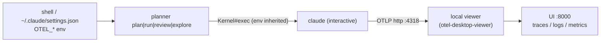

# FINDINGS-001 — OpenTelemetry for planner's agent commands

## Summary

Because planner `exec`s the `claude` CLI, Claude Code's built-in OpenTelemetry (metrics, log events and beta traces) can be turned on with environment variables alone and sent to a local viewer such as otel-desktop-viewer. This works live and after the run, and needs no change to how `claude` is launched. Structural data can replace the estimated token and elapsed figures in the stats with real numbers. It cannot rebuild the "Commands that needed help" table, because without the content flags the command text is not exported.

1. lib/planner/agents/claude.rb:15-35: `plan`, `run`, `review` and `explore` each replace planner with an interactive `claude` process through `Kernel#exec`, which inherits planner's environment.
2. https://code.claude.com/docs/en/agent-sdk/observability: telemetry has three signals, each switched on by environment variables; traces also need `CLAUDE_CODE_ENHANCED_TELEMETRY_BETA=1`.
3. https://code.claude.com/docs/en/monitoring-usage.md: the exporter variables are ignored in a repo's `.claude/settings.json`, so they must come from the shell, `~/.claude/settings.json` or the launch environment.
4. https://code.claude.com/docs/en/monitoring-usage.md: structural telemetry alone gives tool names, durations, tokens, cost, permission decisions and model-request timing, but not prompts, file paths or commands.
5. https://github.com/CtrlSpice/otel-desktop-viewer: otel-desktop-viewer is a single local binary that takes all three signals over OTLP on 4317/4318 and has a UI on 8000. grafana/otel-lgtm is a heavier Docker alternative.
6. https://code.claude.com/docs/en/agent-sdk/observability: watching live works with the default 5-second trace and log export interval; metrics need their 60-second default lowered.
7. lib/planner/agents/claude.rb:15: telemetry from different planner commands can only be told apart if planner tags it, for example through `OTEL_RESOURCE_ATTRIBUTES` in the environment it passes to `exec`. An inbound `TRACEPARENT` is ignored in interactive sessions.
8. lib/planner/prompts/run.md.erb:38-78, lib/planner/prompts/explore.md.erb:93-114: today the agent estimates tokens, and `run` measures elapsed time with `date`; `plan` and `review` write no stats.
9. https://code.claude.com/docs/en/monitoring-usage.md: real tokens, cost and elapsed time are in telemetry. The "Commands that needed help" table can only be partly rebuilt (tool name, category, decision), not the command text.
10. lib/planner/agents/claude.rb:15: planner's process ends at `exec`, so nothing in planner can read telemetry back after the session. Putting real numbers into the files needs a separate step.

## Recommendations

- Set the telemetry variables in your shell or `~/.claude/settings.json` (not in the repo), run otel-desktop-viewer locally, then run one `planner explore` and one `planner run` to see what actually arrives. (findings 2, 3, 5, 6)
- Plan a small change so `Agents::Claude` passes an environment hash to `exec` with `OTEL_RESOURCE_ATTRIBUTES=planner.command=<cmd>,planner.file=<percent-encoded path>`. This makes each session filterable by command and plan, and the launch itself stays the same. (findings 1, 7)
- Check whether your organisation's managed settings already set an OTLP endpoint or protocol. If they do, Claude Code removes conflicting developer-set variables at startup and your local viewer would get nothing. (finding 3)
- Look into a separate `planner stats <file>` command that queries the local viewer's API (port 8000) by `session.id` or `planner.file` and writes real tokens, cost and elapsed time. The API's shape has not been checked. (findings 8, 9, 10)
- Keep the agent-written "Commands that needed help" table. Telemetry could add a count of prompts and refusals by tool and category beside it, but it cannot replace it while content flags stay off. (findings 4, 9)
- Defer `TRACEPARENT`-based nesting under a planner span until moving to `claude -p` or the Agent SDK is on the table. (finding 7)

## Questions

1. How could Claude Code's OpenTelemetry observability be used to get more information on what the planner commands are doing while they run?
2. Could telemetry replace the agent-estimated stats with real numbers?

## Decisions (resolved, do not revisit)

| Decision | Choice |
| --- | --- |
| Which commands are in scope | All agent commands: `plan`, `run`, `review`, `explore` (not `skills`) |
| Live or after the run | Both |
| Where telemetry goes | A local viewer for now |
| Content capture | Structural data only; no `OTEL_LOG_USER_PROMPTS`, `OTEL_LOG_TOOL_DETAILS`, `OTEL_LOG_TOOL_CONTENT` or `OTEL_LOG_RAW_API_BODIES` |
| How `claude` is launched | Unchanged: keep the interactive `exec`; no move to `-p` or the Agent SDK |
| Stats | Explore whether telemetry could replace the estimated stats |

## Findings

### 1. Every agent command hands off to `claude` through `exec`

`Agents::Claude` takes `executor: Kernel.method(:exec)` (`lib/planner/agents/claude.rb:15`) and calls it with `'claude', '--model', ...` in `#plan` (line 20), `#run` (line 24), `#review` (lines 28-29) and `#explore` (lines 33-34). `exe/planner:10` builds it with no arguments, so the real `exec` is used. `exec` replaces the Ruby process with `claude` in interactive mode (there is no `-p`), and the child inherits planner's environment. Any `OTEL_*` or `CLAUDE_CODE_*` variable in the shell that runs `planner` therefore reaches Claude Code without a code change. `Kernel#exec` also accepts an environment hash as its first argument, which is the natural hook if planner ever needs to add variables itself (finding 7).

### 2. Claude Code exports three signals, switched on by environment variables

From https://code.claude.com/docs/en/agent-sdk/observability (the SDK runs the same CLI, so the same applies to planner's direct `claude` launch):

| Signal | Contains | Enable with |
| --- | --- | --- |
| Metrics | Token, cost, session, lines-of-code, active-time and edit-decision counters | `OTEL_METRICS_EXPORTER` |
| Log events | One record per prompt, API request, API error, tool decision, tool result and safety event | `OTEL_LOGS_EXPORTER` |
| Traces (beta) | `claude_code.interaction` → `claude_code.llm_request`, `claude_code.tool` → `claude_code.tool.blocked_on_user` / `claude_code.tool.execution` | `OTEL_TRACES_EXPORTER` plus `CLAUDE_CODE_ENHANCED_TELEMETRY_BETA=1` |

All three also need `CLAUDE_CODE_ENABLE_TELEMETRY=1`. Transport is set with `OTEL_EXPORTER_OTLP_PROTOCOL`, which has no default, and `OTEL_EXPORTER_OTLP_ENDPOINT`. Export errors are silent unless `CLAUDE_CODE_OTEL_DIAG_STDERR=1` is set, or you use `claude --debug-file <path>` and look for `[3P telemetry]` lines (monitoring reference). According to the monitoring reference, tracing is not limited to non-interactive sessions. Only *detailed* beta tracing (`ENABLE_BETA_TRACING_DETAILED`, which adds `claude_code.hook` spans) needs an allowlisted organisation in interactive sessions. Span names and attributes may change while traces are in beta.

A minimal structural-only setup for a local viewer:

```sh
CLAUDE_CODE_ENABLE_TELEMETRY=1
CLAUDE_CODE_ENHANCED_TELEMETRY_BETA=1
OTEL_METRICS_EXPORTER=otlp
OTEL_LOGS_EXPORTER=otlp
OTEL_TRACES_EXPORTER=otlp
OTEL_EXPORTER_OTLP_PROTOCOL=http/protobuf
OTEL_EXPORTER_OTLP_ENDPOINT=http://localhost:4318
OTEL_METRIC_EXPORT_INTERVAL=5000
```



### 3. The variables cannot live in the repo's Claude settings

The monitoring reference (https://code.claude.com/docs/en/monitoring-usage.md, "where these can be set") says Claude Code ignores the OTEL exporter variables in a repo's `.claude/settings.json` and `.claude/settings.local.json`. A repo can only set a signal's exporter to `none` there. The variables work in the developer's shell, the `env` block of `~/.claude/settings.json`, managed settings, or the environment of the launching process. When managed settings set `OTEL_EXPORTER_OTLP_ENDPOINT`, `OTEL_EXPORTER_OTLP_PROTOCOL` or credentials, Claude Code removes conflicting developer-set variables at startup. I did not read any managed settings file, because it is outside the working directory.

### 4. What structural telemetry shows, with content flags off

From the monitoring reference, these are available without any `OTEL_LOG_*` flag:

- **Spans:** `claude_code.interaction` (`interaction.sequence`, `interaction.duration_ms`), `claude_code.llm_request` (`model`, `ttft_ms`, `input_tokens`, `output_tokens`, `cache_read_tokens`, `cache_creation_tokens`, `success`, `stop_reason`), `claude_code.tool` (`tool_name`, `duration_ms`, `tool_use_id`), `claude_code.tool.blocked_on_user` (`duration_ms`, `decision`, `source`) and `claude_code.tool.execution` (`duration_ms`, `success`, `error`, `error_class`).
- **Events:** `claude_code.api_request` (`model`, `cost_usd`, `duration_ms`, token counts), `claude_code.api_error`, `claude_code.tool_decision` (`tool_name`, `decision`, `source`: `config`, `hook`, `user_permanent`, `user_temporary`, `user_abort` or `user_reject`), `claude_code.tool_result` (`tool_name`, `success`, `duration_ms`, `error_type`, input and result sizes) and `claude_code.safety_event` (`category` such as `permission_rule`, `safety_check`, `sandbox_override`, `sandbox_network` or `user_rejected`; `decision`; `reason_code`; `tool_class`; `sandbox_violation_count`; `sandbox_enabled`).
- **Metrics:** `claude_code.token.usage` (by `type`), `claude_code.cost.usage`, `claude_code.active_time.total` (`user` compared with `cli`) and `claude_code.session.count`.
- **Standard attributes:** `session.id`, `prompt.id` (links all events from one prompt), `event.sequence` and keys from `OTEL_RESOURCE_ATTRIBUTES`.

These are hidden by the content flags you have ruled out: prompt text (`OTEL_LOG_USER_PROMPTS`), `tool_parameters` and `tool_input` with Bash commands, file paths and URLs, plus input-derived span attributes such as `file_path` on `claude_code.tool` (`OTEL_LOG_TOOL_DETAILS`, monitoring reference "Security and privacy"), tool output (`OTEL_LOG_TOOL_CONTENT`) and raw API bodies.

For planner, this means each session shows how many model calls and tool calls it made, which tools they were, how long each took, how long the agent waited on you at permission prompts (`blocked_on_user`), which calls failed or were refused and why (`safety_event.category`), and the tokens and cost per request. It does not show *which* file or command was involved.

### 5. Local viewer options

- **otel-desktop-viewer** (https://github.com/CtrlSpice/otel-desktop-viewer): takes traces, metrics and logs; OTLP gRPC on 4317 and HTTP on 4318; UI and a JSON-RPC API on 8000. Installs with `brew tap ctrlspice/otel-desktop-viewer && brew install --cask otel-desktop-viewer`, or via `docker run -p 8000:8000 -p 4317:4317 -p 4318:4318 ghcr.io/ctrlspice/otel-desktop-viewer:latest`. Data is kept in memory (512 MB cap) by default, or in DuckDB with `--db <file>` for keeping history across restarts.
- **grafana/otel-lgtm** (https://github.com/grafana/docker-otel-lgtm): one Docker image with a Collector, Tempo, Loki, Prometheus and Grafana on 3000. OTLP is on 4318 (and 4317). It is meant for development and testing, and is heavier but supports dashboards across many runs.

otel-desktop-viewer is the smaller step for "a local viewer for now". Docker runs unsandboxed under the org policy, so either image should be started deliberately by you.

### 6. Watching live and looking back

According to the observability guide, traces and logs export every 5 seconds by default and metrics every 60 seconds. With a viewer open, spans and events for a running `planner run` appear within about 5 seconds. Lowering `OTEL_METRIC_EXPORT_INTERVAL` (and optionally `OTEL_TRACES_EXPORT_INTERVAL` / `OTEL_LOGS_EXPORT_INTERVAL`) brings the counters closer to real time. To look back after the run, the viewer must keep data, for example with otel-desktop-viewer's `--db`. Claude Code flushes on a clean exit, but the flush has a time limit, and data is lost if the process is killed. The `console` exporter writes to stdout. The docs do not say how it behaves in an interactive TUI and I did not test it, so OTLP to a local viewer is the safer route.

### 7. Telling planner commands apart

Every span and event carries `service.name=claude-code` and `session.id`, but nothing says which planner command or plan file started the session. The observability guide shows `OTEL_SERVICE_NAME` and `OTEL_RESOURCE_ATTRIBUTES` being added to every span, metric and event. Values must be percent-encoded, because commas, spaces and `=` are reserved. Planner could set something like `planner.command=run,planner.file=docs%2Fplans%2F...%2FPLAN-001.md` by passing an environment hash to the existing `@executor.call` (`lib/planner/agents/claude.rb:20-34`). That changes the environment but not the launch. The guide also describes `TRACEPARENT` propagation so a parent span (one from planner) would contain the `claude_code.interaction` spans, but it says "Interactive CLI sessions ignore inbound `TRACEPARENT` entirely; only Agent SDK and `claude -p` runs honor it". That rules it out under the decision to keep the interactive launch. Note also that `session.id` changes if you run `/clear` mid-session, which matters for `review`, where the session carries on after the summary.

### 8. How stats are produced today

- `run`: the prompt asks the agent to run `date -u` at the start and finish, and write Status, Started, Finished, Elapsed, Model, Tokens "(estimate)" and a "Commands that needed help" table to the end of the plan file (`lib/planner/prompts/run.md.erb:6-7, 38-78`).
- `explore`: Model, Tokens "(estimate)" and the same commands table, with no timing (`lib/planner/prompts/explore.md.erb:93-114`).
- `plan` and `review`: no stats (a grep for `stats|token|model` in `plan.md.erb` and `review.md.erb` found nothing).

The token figure is a guess by the agent, because the agent cannot see its own usage.

### 9. Mapping stats fields to telemetry

| Stats field | Telemetry source (structural) | Fully replaceable? |
| --- | --- | --- |
| Tokens | Sum of `claude_code.token.usage` by `type`, or `input_tokens` / `output_tokens` / cache counts on `claude_code.api_request` / `claude_code.llm_request`, filtered by `session.id` | Yes; cost (`cost_usd`) comes free |
| Started / Finished / Elapsed | First and last `claude_code.interaction` span in the session; `claude_code.active_time.total` splits `user` and `cli` time | Yes, and covers all four commands, not only `run` |
| Model | `model` on `llm_request` / `api_request` | Yes, and shows any subagent or fallback models too |
| Status / Stopped at / Reason | None: these depend on meaning, not structure | No |
| Commands that needed help | `claude_code.tool_decision` with `source` `user_temporary`, `user_permanent` or `user_reject`; `claude_code.safety_event` (`category`, `reason_code`, `sandbox_violation_count`); `claude_code.tool.blocked_on_user` durations; `tool_result.success=false` for retries | Partly: tool name, category and wait time, but not the command text (needs `OTEL_LOG_TOOL_DETAILS`) or the "suggested fix" |

### 10. Planner cannot write the real numbers itself today

Once `exec` runs (`lib/planner/agents/claude.rb:15`), the planner process is gone, so there is no point after the session where planner could query telemetry and add to the file. The agent cannot reliably do it either: `explore` and `review` have no Bash tool (`EXPLORE_TOOLS`, `REVIEW_TOOLS` at lines 11-13), and metrics may not have flushed before the agent writes its stats. Without changing the launch, real numbers need a separate step after the session, such as a `planner stats <file>` command that queries the local viewer (otel-desktop-viewer exposes a JSON-RPC API on 8000) for the session tagged with that file (finding 7). I have not checked that API's methods or response shape.

---

## Stats

| Field | Value |
| --- | --- |
| Model | opus |
| Tokens | ~75k (estimate) |
