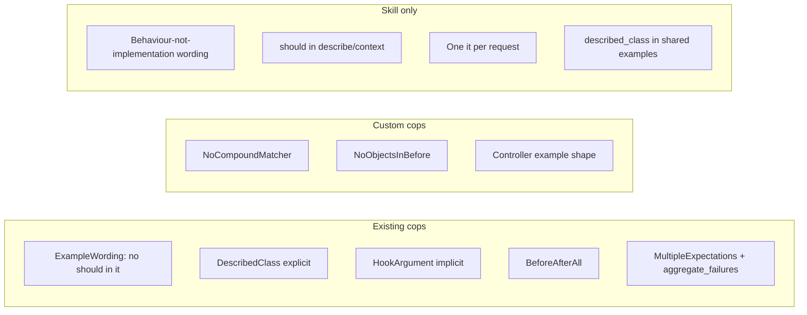

# FINDINGS-001 — Converting the RSpec skills to RuboCop checks

## Summary

About half of the two RSpec skills can become static checks with cops that already exist in
rubocop-rspec and rubocop-rspec_rails. Configured to match the skills, existing cops cover
"no should" (for `it` only), "never `described_class`", "plain `before` with no
`:each`/`:example`", "no `before(:all)`/`before(:context)`", and "tag multiple expectations
with `:aggregate_failures`". Neither gem has a cop for "no `.and`/`&` compound matchers",
"never create objects in `before`", or any of the controller-spec rules (request on the
first line, status checked first, no request in `before`). Those would need custom cops.
"Descriptions say what the code does, not how" can't be checked statically, so it stays a
skill. rubocop-rails has no cop for any of these rules. Three things conflict with the
skills as written. RuboCop checks whole files, but the skills say to leave untouched specs
alone. `MultipleExpectations` requires `:aggregate_failures`, which the controller skill
forbids. And this repo's own specs use `described_class`.

## Recommendations

- Decide where the config lives (this repo, or a shareable config shipped in the planner gem for consumer apps such as a Rails app) before planning any work (findings 1, 6).
- Plan a config that enables `RSpec/DescribedClass` (`EnforcedStyle: explicit`), `RSpec/HookArgument` (`implicit`), `RSpec/BeforeAfterAll`, `RSpec/ExampleWording`, and `RSpec/MultipleExpectations` excluded from controller and request specs (findings 2, 3).
- Prototype two small custom cops, `NoCompoundMatcher` and `NoObjectsInBefore`, which cover the most valuable gaps (finding 4).
- Treat the controller-spec rules as candidates for one custom cop, or leave them as a skill. Check the cost before you commit to it (finding 5).
- Keep both skills, trimmed to what RuboCop can't check, rather than deleting them (findings 4, 7).
- Grandfather existing offences with `rubocop --auto-gen-config` (`.rubocop_todo.yml`) so the "don't rewrite untouched specs" rule still holds (finding 6).

## Questions

1. Can the rules in the RSpec skills (`writing-rspec`, `writing-rspec-controller-specs`) be turned into static checks with RuboCop?
2. Which existing cops in rubocop, rubocop-rspec and rubocop-rails can be configured to match each rule?
3. Which rules have no acceptable existing cop, so they would need a custom cop?

## Decisions (resolved, do not revisit)

| Decision | Choice |
| --- | --- |
| Prefer existing cops over custom ones | Use existing cops configured to match the skills. Write custom cops only where no acceptable cop exists (from the brief) |

## Findings

### 1. The skills in scope and the current RuboCop setup

- The two RSpec skills ship with the gem: `lib/planner/skills/writing-rspec/SKILL.md` and
  `lib/planner/skills/writing-rspec-controller-specs/SKILL.md`. They are packaged through
  `planner.gemspec:17` (`lib/planner/skills/**/*`) and copied into `.claude/skills` by
  `lib/planner/commands/skills/install.rb`.
- This repo already runs RuboCop 1.92.1 with rubocop-rspec 3.10.2 (`Gemfile.lock:36,53`),
  loaded as a plugin with `NewCops: enable` (`.rubocop.yml:1-7`). rubocop-rails and
  rubocop-rspec_rails are not installed.
- This repo's own specs break the `described_class` rule. They use it throughout, for
  example `spec/planner/cli_spec.rb:4` and `spec/planner/commands/toc_spec.rb:4`, which
  matches the rubocop-rspec default. The skills look aimed at a Rails consumer app, since
  their examples use FactoryBot, `Widgets::…` and controller specs, rather than at this
  repo.

### 2. Rules in the writing-rspec skill matched to cops

Sources: https://docs.rubocop.org/rubocop-rspec/latest/cops_rspec.html and the cop source on
GitHub (`example_wording.rb`, `described_class.rb`).

| Skill rule (`writing-rspec/SKILL.md`) | Existing cop | Config to match | Fit |
| --- | --- | --- | --- |
| No "should" in descriptions (l.23) | `RSpec/ExampleWording` | defaults | **Partial.** Checks `it` only (matcher `(block (send _ :it …))`), and only "should" at the start (`/\Ashould(?:n't)?\b/i`). Misses `describe`, `context`, `specify` and `example`. Autocorrects. |
| Say what the code does, not how (l.12-20) | none | — | **Not statically checkable.** It needs semantic judgement. `ExampleWording`'s `DisallowedExamples` can only block fixed phrases such as `works`. |
| No `.and` / `&` compound matchers (l.39) | none | — | **Gap.** `RSpec/ChangeByZero` and `RSpec/DiscardedMatcher` mention `.and` but address other problems. |
| One `expect` per line, tagged `:aggregate_failures` (l.40) | `RSpec/MultipleExpectations` | `Max: 1` (default). Tagged examples are exempt. | **Good.** Forces the tag whenever an example has more than one `expect`. Conflicts with the controller skill (finding 3). |
| Never create objects in `before` (l.59-66) | none | — | **Gap.** `RSpec/InstanceVariable`, `RSpec/ExpectInHook` and `RSpec/LeakyLocalVariable` are related but don't flag `create`/`.new`/`double` in hooks. |
| Plain `before`, no `:each`/`:example` (l.68-69) | `RSpec/HookArgument` | `EnforcedStyle: implicit` (default) | **Exact.** Autocorrects. |
| Never `before(:all)`/`before(:context)` (l.68) | `RSpec/BeforeAfterAll` | defaults (excludes `spec_helper.rb`, `rails_helper.rb`, `support/**`) | **Exact** (also flags `after`). |
| Never `described_class`, use the full name (l.128-132) | `RSpec/DescribedClass` | `EnforcedStyle: explicit`, `SkipBlocks: true` recommended | **Good.** Flags every `described_class` and autocorrects to the constant as written in `describe`. It has no shared-examples exception (l.133-135), and a top-level `shared_examples` is not analysed, so it is skipped silently. Autocorrect is unsafe with `SkipBlocks: false`. |

### 3. The aggregate_failures conflict between the two skills

`writing-rspec-controller-specs/SKILL.md:12-15` says controller and request examples are
**not** tagged `:aggregate_failures`, but they have several expectations (l.74-79).
`RSpec/MultipleExpectations` would flag every such example. Two ways to resolve it:

- exclude `spec/controllers/**` and `spec/requests/**` from `RSpec/MultipleExpectations`, or
- disable the cop and rely on the skill.

`RSpec/MultipleExpectations` also flags examples that have several `expect`s but no
compound matcher, which goes beyond what the skill asks. The skill only says to tag the
example *when* you split a compound matcher.

### 4. Custom cops for the gaps in writing-rspec

Two gaps can be checked and are valuable:

- **NoCompoundMatcher**: flag `.and`, `.or`(?), `&` and `|` on the matcher argument of
  `expect(...).to`. In the AST that is a `send` with method `:and`/`:&` inside the argument of
  a `:to`/`:not_to` send whose receiver is `expect(...)`. It is a small `NodePattern` cop. The
  skill names only `.and` and `&`, so whether `.or` should be in scope is open.
- **NoObjectsInBefore**: inside a `before` hook block, flag calls to a configurable method
  list: `create`, `create_list`, `build`, `build_stubbed`, `build_list`, `double`,
  `instance_double`, `class_double`, `spy`, `instance_spy`, and `Const.new`/`Const.create`.
  The skill's own allowances (stubs, sign-in, headers, time travel) pass naturally because
  they aren't in the list. One edge case: `allow(x).to receive(:y).and_return(build(:z))` in
  a stub would be flagged. Decide whether the cop should ignore arguments to
  `receive`/`and_return`.

Custom cops would live in a `rubocop-…` extension or a `lib/rubocop/cop/…` folder loaded with
`require:`/`plugins:` in `.rubocop.yml`.

### 5. Controller-spec rules

| Skill rule (`writing-rspec-controller-specs/SKILL.md`) | Existing cop | Fit |
| --- | --- | --- |
| `before` never makes the request (l.21) | none | **Gap.** Custom: flag `get/post/put/patch/delete/head` in a `before` block in controller and request specs. |
| Request on the first line of `it`, then a blank line (l.27-28) | none | **Gap.** Custom. |
| First expectation is `expect(response).to have_http_status(...)`, then a blank line (l.29-33) | `RSpecRails/HaveHttpStatus` (rubocop-rspec_rails) only prefers `have_http_status` over `eq` on `response.status` | **Gap** for the ordering. Custom. |
| Any status form allowed: `:success`, number, … (l.30-31) | `RSpecRails/HttpStatus` defaults to `symbolic` | **Conflicts.** Disable it, or accept the default if the team is happy with symbolic only. |
| All expectations for one request in one `it` (l.34-36) | none | **Not reliably checkable.** It needs to know that two examples share the same setup and request. |

The first three gaps fit one custom cop that inspects the first statements of each example
in `spec/controllers`/`spec/requests`. That cop is more fiddly than those in finding 4
because of blank-line handling and `type:` metadata.

rubocop-rails has nothing for these rules. The only cops whose default `Include` covers
`spec/**` are `Rails/HttpPositionalArguments` and `Rails/I18nLocaleAssignment`, and
`Rails/HttpStatus` checks `render`/`head`/`redirect_to`/`assert_response`, not
`have_http_status` (https://docs.rubocop.org/rubocop-rails/latest/cops_rails.html).
rubocop-rspec_rails' 10 cops are listed at
https://docs.rubocop.org/rubocop-rspec_rails/latest/cops_rspecrails.html.

### 6. RuboCop checks whole files, but the skills cover only what you touch

Both skills say to apply the rules only to what you write or change and not to rewrite
untouched specs (`writing-rspec/SKILL.md:8-10`, `writing-rspec-controller-specs/SKILL.md:10-11`).
The eval suite tests this explicitly: `writing-rspec/evals/evals.json` ids 3, 5 and 8 expect
existing `should`, `.and`, `before { create … }` and `described_class` lines to stay. RuboCop
has no changed-lines mode. The usual ways to reconcile the two are:

- `rubocop --auto-gen-config`, which writes a `.rubocop_todo.yml` that excludes existing
  offending files per cop
- running RuboCop only on changed files in CI, which still flags old lines in those files
- disabling the new cops by default and enabling them by path

Enabling `RSpec/DescribedClass: explicit` in a codebase that uses `described_class`
everywhere would flag a very large number of lines, as this repo's specs show (finding 1).

### 7. What stays a skill

Even with every cop in place, the skills still guide the agent before it writes code, and
RuboCop then catches regressions. Converting adds a check after the code is written; it
doesn't replace the guidance.
