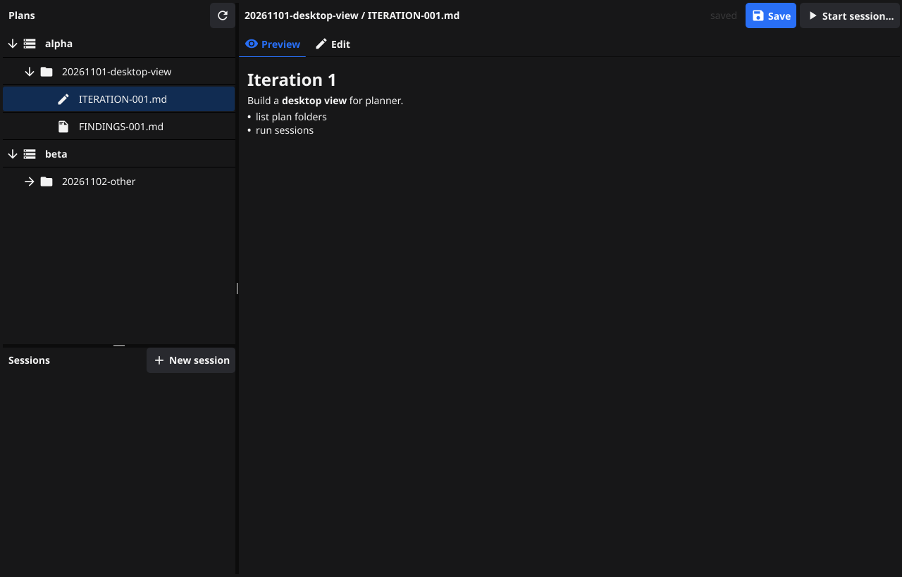
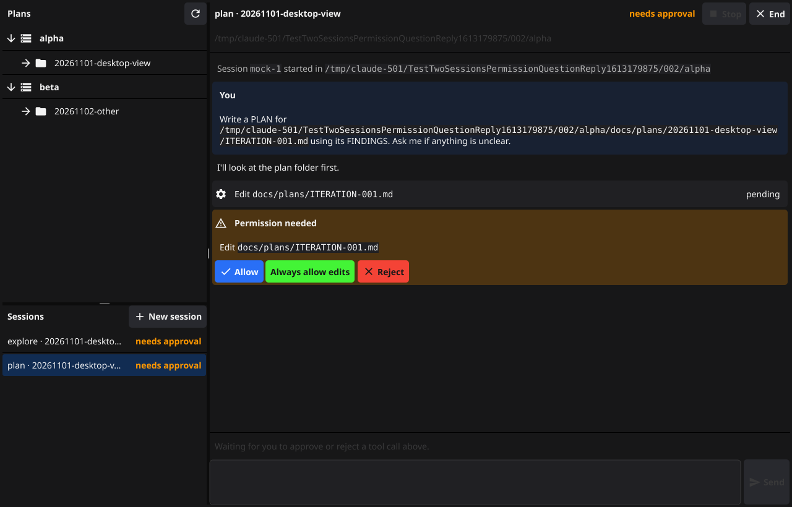
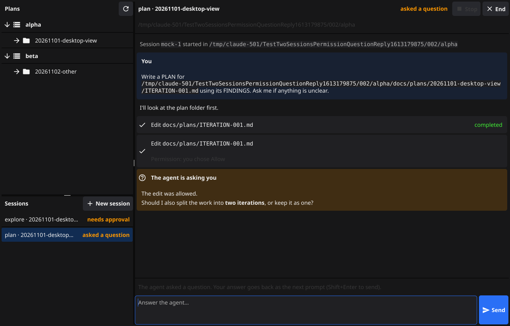
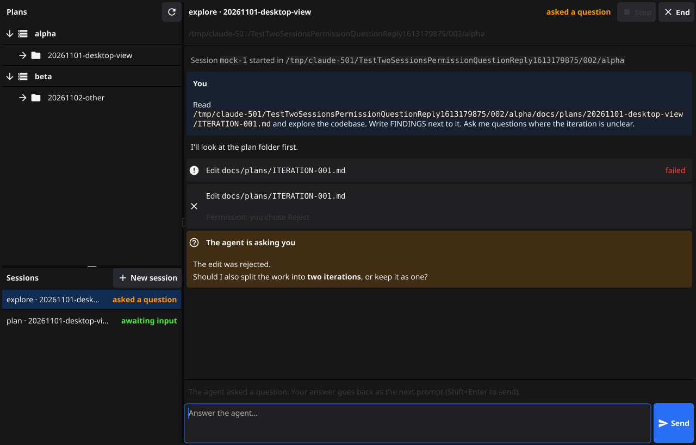

# Go desktop spike (Fyne + ACP)

A throwaway spike of a desktop app for planner, written in Go with
[Fyne](https://fyne.io). It finds plan folders under a parent folder of repos,
shows and edits plan markdown, and runs explore/plan/run agent sessions side by
side over the [Agent Client Protocol](https://agentclientprotocol.com).

Screenshots below come from Fyne's headless test driver running the real UI
code with the default theme (`SHOTS=dir go test .`). Nobody has looked at a
live window yet: the spike's sandbox blocks opening apps.

| | |
|---|---|
|  |  |
|  |  |

## Fyne vs Gio

Both draw their own widgets. Neither uses AppKit controls, so neither looks
fully native on macOS.

| Criterion | Fyne v2.8.2 | Gio v0.10.3 |
|---|---|---|
| Native feel | Material-like widget set on GLFW + OpenGL. Has a native macOS menu bar (`SetMainMenu`) and Cmd shortcuts. Looks like Fyne, not like macOS. | Immediate mode, Metal on macOS, smooth and crisp text. The look is whatever you draw, and you draw everything. |
| Text editing | `widget.Entry` multi-line, wrapping, monospace, placeholder, submit. Good enough for ITERATION files. | `widget.Editor` is solid, but you build the chrome yourself. |
| Markdown | Built in: `RichText.ParseMarkdown` (goldmark). Headings, lists, bold, code blocks. | Only through `gioui.org/x/markdown` and `x/richtext`, which are experimental. |
| Rich text | `RichText` segments, styles, and wrapping. | `x/richtext` spans. |
| Virtualised lists | `List`, `Tree` and `Table` are virtualised. Variable row heights are awkward. | `layout.List` is virtualised and handles variable heights naturally, which suits transcripts. |
| Widgets this app needs | Tree, split panes, tabs, forms, dialogs, list, activity spinner, cards are all in core. | No tree or split view in core. They would have to be written or taken from `gio-x/component`. |
| Accessibility | First pass in 2.8, off by default, enabled with `-tags accessibility` ([v2.8 release post](https://fyne.io/blog/2026/07/13/fyne-v2.8-released/)). | A `semantic` API exists. I found no evidence of macOS VoiceOver support. |
| Maturity | v2, stable API, large widget set. | Pre-1.0, API still changes, repo on sr.ht. |

**Pick: Fyne.** This app is mostly standard widgets: a tree, a list with
badges, tabs, forms, an editor, and markdown. Fyne has all of them, plus
markdown rendering, in core. In Gio, a tree view and split panes alone would
use up most of a spike. Gio's strengths (variable-height virtual lists, better
text rendering, Metal) matter most for the transcript. They would not make up
for building every other widget by hand.

## Run it

```sh
cd spikes/go
go run . /path/to/parent-folder                 # real Claude Code via the ACP adapter

# Mock agent, no network. The agent runs with the repo as cwd, so use an absolute path.
go build -o /tmp/mockagent ./cmd/mockagent
MOCK_DELAY_MS=150 go run . -agent /tmp/mockagent /path/to/parent-folder
```

Ways to choose the agent command, any of these:

- the `-agent` flag
- the `$PLANNER_AGENT` environment variable
- the "Agent" field in the New session dialog, set per session

The default is `npx -y @agentclientprotocol/claude-agent-acp`. That is the
current name of Zed's Claude Code adapter, v0.107.0 on npm as of 2026-11-13.
Both `@zed-industries/claude-code-acp` and `@zed-industries/claude-agent-acp`
are deprecated on npm and point to this package.

Other commands:

- `go run ./cmd/acpcli -cwd DIR "prompt"` runs one turn headless and prints
  the transcript. It rejects any permission request.
- `go test ./...` runs discovery, ACP (against the mock agent) and headless UI
  tests.
- `SHOTS=/some/dir go test .` writes PNG screenshots of each UI step.

## Layout

- `plans/`: finds `docs/plans/*/` in the parent and its immediate child repos,
  and orders files ITERATION, FINDINGS, PLAN, REVIEW per number. It also
  works out the next ITERATION name.
- `session/`: one agent process and one ACP session each. It keeps a
  UI-agnostic transcript (`Snapshot()`), a status, permission handling and
  cancel. It uses [`github.com/coder/acp-go-sdk`](https://github.com/coder/acp-go-sdk)
  v0.13.5.
- `cmd/mockagent/`: a hand-rolled JSON-RPC ACP agent. It streams chunks, makes
  a tool call, requests permission, finishes the tool according to the
  answer, and ends the turn with a question. Later turns echo the reply.
- `cmd/acpcli/`: a headless driver for the session package.
- `main.go`, `ui.go`, `docview.go`, `sessionview.go`: the Fyne UI.

## What works (tested)

- **Discovery** (`plans/plans_test.go`): finds plans in the parent and in
  child repos. It skips hidden folders, deeper nesting and stray files, and
  orders files per iteration. Only ITERATION files are editable.
- **Editing** (`ui_test.go` TestEditAndSaveIteration): select a file in the
  tree, preview the rendered markdown, type in the Edit tab, and save with
  the Save button or Cmd+S. Saving writes the file. The state label moves
  from saved to edited and back. FINDINGS files are read only, with the Edit
  tab disabled and Save hidden. "New iteration" on a folder is meant to
  create the next `ITERATION-NNN.md` and open it for editing. No test covers
  this path; only `NextIterationName` is tested.
- **ACP** (`session/session_test.go`, 50 runs under `-race`):
  - initialize, then session/new, then session/prompt.
  - Streamed `agent_message_chunk`s merge into one message.
  - `tool_call` and `tool_call_update` update one row in place (pending,
    then completed or failed).
  - `session/request_permission` becomes a card with one button per option.
    The chosen option is recorded on the card.
  - At end of turn the status is "awaiting input", or "asked a question" if
    the last paragraph asks one.
  - The reply box sends the next `session/prompt`.
  - Stop sends `session/cancel` and answers pending permissions with
    `cancelled`, as the spec requires.
  - A bad agent command puts the session into the error state.
- **Two concurrent sessions** (session and UI tests): each has its own
  process. Rejecting in one leaves the other waiting. The sidebar list shows
  a coloured badge per session: running, needs approval, asked a question,
  awaiting input, error. The window title shows "Planner — N waiting for
  you". A notification fires when a session starts needing you (unverified
  in a live window).
- **Real adapter** (`cmd/acpcli`, run against `@agentclientprotocol/claude-agent-acp`
  with my Claude login):
  - Plain turn: the session was up after 9.5 s (npx plus SDK init) and the
    turn ended at 12.2 s. The status ended as "question" for "...What would
    you like to do first?".
  - Write, Bash and WebFetch turns: the tool_call rows streamed and updated
    to completed or failed, including a subagent tool call.
  - Later sessions took 6.6–7.7 s to start.

## What did not work, or needs care

- **SDK ordering gap.** acp-go-sdk queues notifications in order, but it
  dispatches inbound requests such as `session/request_permission` on their
  own goroutine straight away (`connection.go:412`). A permission request can
  overtake chunks the agent sent before it. In 100 runs without a fix, 7 put
  the permission card above earlier text. `session/barrier.go` counts
  `session/update` lines as they come off stdout and makes RequestPermission
  wait until they are all handled. That gave 0 failures in 100 runs. This is
  worth reporting upstream.
- **Real permission prompts were not exercised.** My Claude settings
  auto-approved every tool I tried (Write, Bash, WebFetch), so the adapter
  never sent `request_permission`. The mock agent covers that path.
- **Question detection is a heuristic.** The first version checked only for
  a trailing "?". Real output put the question mid-paragraph ("What would you
  like to do instead? I could try..."), so it now checks for any "?"
  sentence in the last paragraph. The reply box opens after every turn
  either way. The question styling is only emphasis.
- **Fyne layout quirks I hit:**
  - The bundled font has no ⚑, which rendered as a replacement box.
  - A label changing width does not re-layout its parent, so I had to call
    `Refresh` on the container.
  - A truncating label in a Border's left slot collapses to "…".
  - All three are fixed, but they show that polish takes manual work.
- **Transcript is not virtualised.** It is a VBox in a scroll, with rows
  cached per entry revision. `widget.List` needs a manual per-row
  `SetItemHeight` for wrapped markdown, so very long sessions will slow
  down. Streaming re-parses only the message that changed, and change
  callbacks are coalesced into one `fyne.Do` per session.
- **No blocking "save changes?" dialog.** Fyne dialogs are async, so the doc
  view autosaves the ITERATION file when you navigate away.
- **One adapter process per session.** Each session takes 6–10 s to start.
  A real app should install the adapter rather than resolve it through npx,
  or host several sessions in one adapter process.
- **Terminal capability not implemented.** It is advertised as false. File
  system read and write are implemented.
- **Sandbox build issues (environment, not Fyne):**
  - `go get` failed TLS verification (`x509: OSStatus -26276`) and had to
    run outside the sandbox.
  - The default GOCACHE was not writable, so I used `GOCACHE=$TMPDIR/...`.
  - The `~/.npm` cache has root-owned files, so I used
    `npm_config_cache=$TMPDIR/...`.
- cgo built cleanly with the Command Line Tools. The only output is a
  harmless `ld: warning: ignoring duplicate libraries: '-lobjc'`.

## Numbers

| | |
|---|---|
| Cold build (empty GOCACHE, modules downloaded) | 20 s wall (63 s CPU) |
| Incremental build after editing `ui.go` | 2.2 s |
| Binary (`go build`) | 34 MB |
| Binary (`-ldflags="-s -w"`) | 24 MB |
| Direct deps | `fyne.io/fyne/v2` v2.8.2, `github.com/coder/acp-go-sdk` v0.13.5 |
| Modules linked | 26 (go-gl/glfw, go-gl/gl, go-text, goldmark, x/image, ...) |
| System frameworks | AppKit, Cocoa, OpenGL, CoreVideo, IOKit, UserNotifications, ... |
| Code | about 2,600 lines including tests and the mock agent |
| Full `go test ./...` | about 5 s |

## UX assessment

Good:

- **Fast to build.** Every requested feature, including markdown preview,
  went in on the first pass with core widgets.
- **The permission and question flows read well.**
  - A permission request is an amber card in the transcript, with
    colour-coded buttons that follow the option kind: Allow is blue, Always
    allow is green, Reject is red.
  - Once answered, the card collapses to "Permission: you chose X" with a
    tick or a cross.
  - A question that ends the turn gets an amber "The agent is asking you"
    panel. The hint above the reply box changes, and the reply box gets
    focus.
- **Status is visible at a glance.** The badges in the sidebar and the
  window title count show which of several sessions needs you.
- **Headless testing.** Fyne's test driver let me drive and screenshot the
  real UI without a display. None of the other candidates offered this.

Weak:

- **It does not feel like a Mac app.**
  - It uses Fyne's own Material-style theme and widgets, rendered through
    OpenGL, which Apple has deprecated.
  - It has no native text system: no system spell check, no Services menu,
    and no native text selection behaviour in the markdown preview.
  - Scrolling and resize behaviour cannot be confirmed without a live window.
- **Accessibility is behind a build tag** and is described as a first pass.
- **The markdown renderer is basic.** Spacing is tight and there is no
  syntax highlighting. Tables were not tried.
- **Layout polish needs manual work** (see the Fyne quirks above).
- **Long transcripts** would need a custom virtualised widget.

Verdict: Fyne is the most productive way to build this in Go, and the
ACP/session layer in Go is pleasant: the SDK fits, apart from the ordering
gap. But since UX is the top criterion, a non-native look and early
accessibility are real costs next to SwiftUI. If Go is chosen, the
`session/` and `plans/` packages carry over as they are, whichever UI sits
on top.
